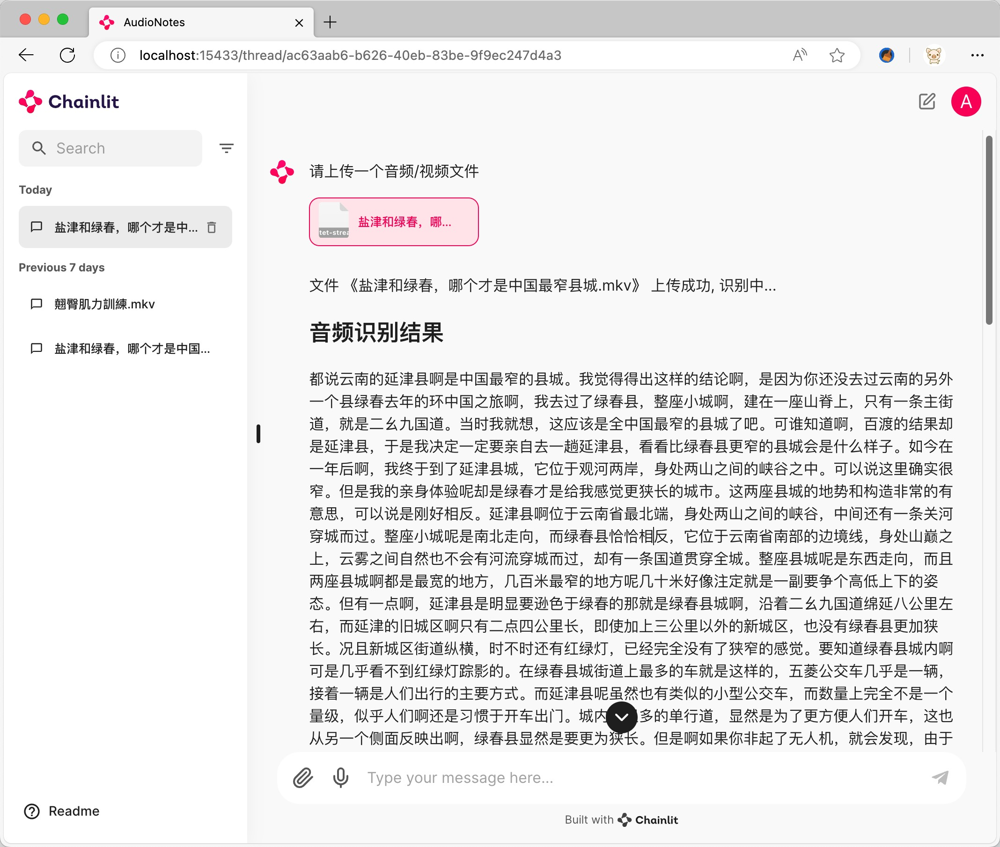
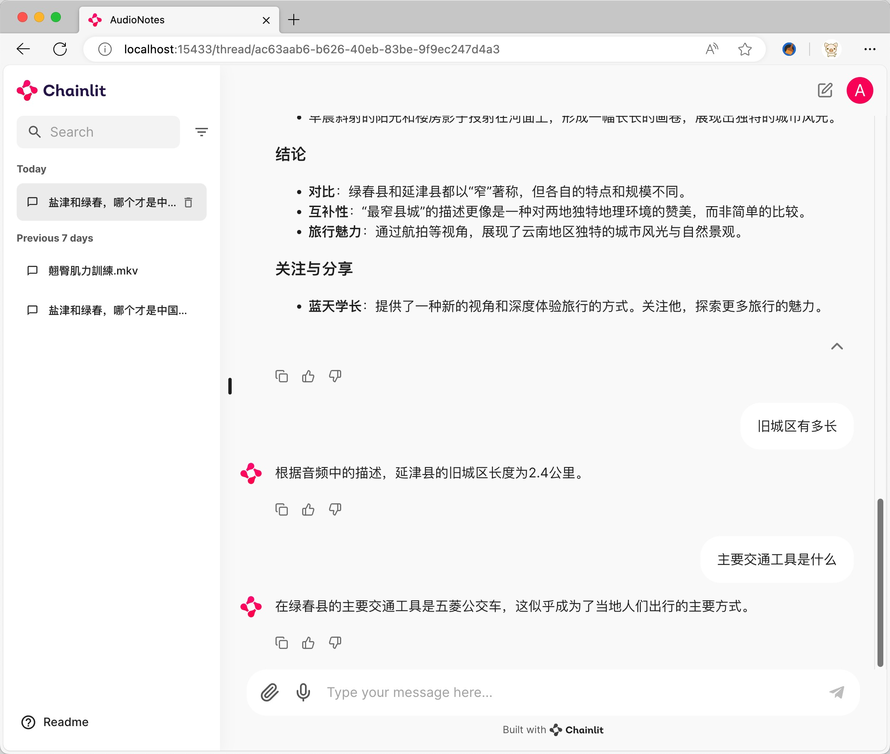

# AudioNotes

**English** | [简体中文](README.md)

## Turn audio and video into structured notes, powered by FunASR and Qwen2

AudioNotes quickly extracts the content of audio/video files and uses a large language model to organize it into a clean, structured Markdown note that is easy to read.

FunASR: https://github.com/modelscope/FunASR

Qwen2: https://ollama.com/library/qwen2

## Screenshots

### Transcribe and summarize audio/video



### Chat with your audio/video content



## Getting Started

### ① Install Ollama

Download and install Ollama for your operating system:

https://ollama.com/download

### ② Pull a model

Using `Qwen2 7B` as an example (https://ollama.com/library/qwen2):

```bash
ollama pull qwen2:7b
```

### ③ Deploy the service

There are two ways to deploy: with Docker, or locally.

#### Docker (recommended) 🐳

```bash
curl -fsSL https://github.com/harry0703/AudioNotes/raw/main/docker-compose.yml -o docker-compose.yml
docker-compose up
```

Once the containers are up, open http://localhost:15433/

> The default login is username `admin`, password `admin` (you can change both in `docker-compose.yml`).

#### Local deployment 📦

Requires a reachable PostgreSQL database.

```bash
conda create -n AudioNotes python=3.10 -y
conda activate AudioNotes
git clone https://github.com/harry0703/AudioNotes.git
cd AudioNotes
pip install -r requirements.txt
```

Rename `.env.example` to `.env` and adjust the configuration values.

```bash
chainlit run main.py
```

Once the service is running, open http://localhost:8000/

> The default login is username `admin`, password `admin` (you can change both in the `.env` file).
